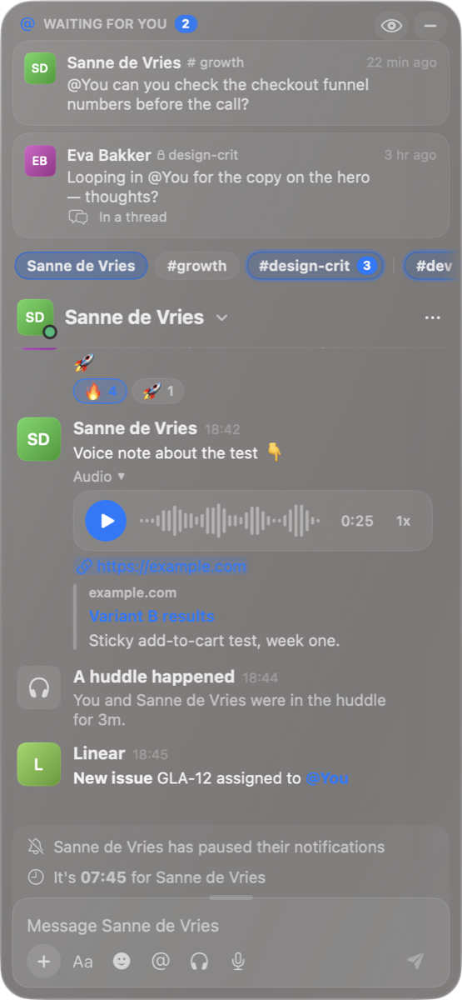

# Glance

Slack, always in view on your Mac: a Liquid Glass panel on the right of your screen.

- **Waiting for you** at the top: mentions and DMs you haven't answered yet. They go away
  once you reply, here or anywhere else.
- **Tabs** for your conversation and favourite channels. Channels with new messages light up.
- **The chat** works like Slack: threads, reactions, images (Quick Look), audio,
  link previews, files, voice notes, emoji and @-mentions.
- **Huddles**: see who's in one and join it in Slack with one click.
- **Swipe it away** with two fingers (or the thumb wheel of an MX Master) and back again,
  minimize it to a small tab, or blur all text when sharing your screen.

**[⬇︎ Download the latest version](https://github.com/antaflu/glance/releases/latest)**

 

## Installing

1. Download `Glance-<version>.dmg` from the [latest release](https://github.com/antaflu/glance/releases/latest),
   open it and drag **Glance** into **Applications**.
2. **Open it the first time with a right-click**: right-click Glance in Applications → **Open** → **Open**.
   Glance isn't from the App Store, so macOS asks this once. (Or: System Settings →
   Privacy & Security → **Open Anyway**.)
3. **Connect Slack.** Glance opens its settings:
   - Click **Create Slack App…** and pick your workspace. The app's permissions are filled in
     for you (they're also on your clipboard: *From a manifest* → paste).
   - Click **Install to Workspace** → **Allow**.
   - Under **OAuth & Permissions**, copy the **User OAuth Token** (`xoxp-…`), paste it into
     Glance and click **Connect**. The token stays in your Mac's keychain; Glance talks
     to Slack directly and nowhere else.
4. **Pick your conversation**: click the name at the top of the panel.

When macOS asks whether Glance may use its keychain item or the microphone (for voice
notes), choose **Always Allow** / **OK**.

Needs macOS 14 or later; Liquid Glass on macOS 26 and later. Apple silicon and Intel.
